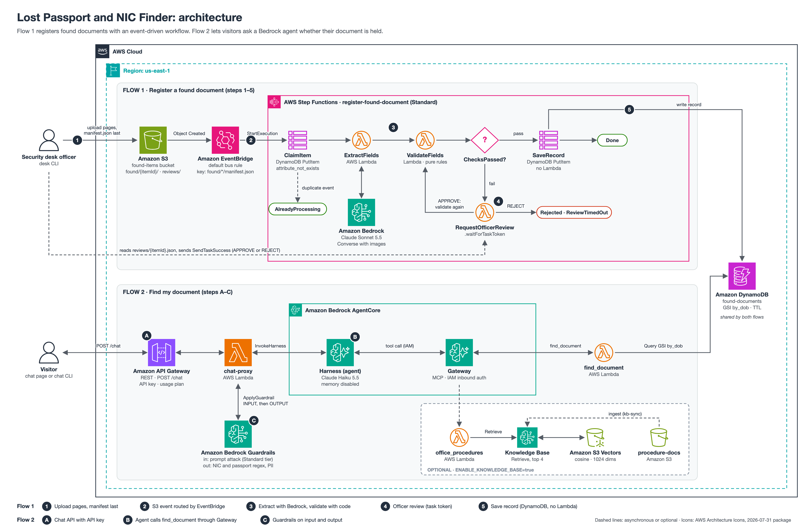

# Lost Passport and NIC Finder

A hands-on workshop on **event-driven architecture** and **generative AI on AWS**.

The passport office and the NIC office share one building, and visitors lose passports and NICs there every day. Security keeps the found documents in a cupboard, and it's hard to tell whether a particular person's document is there. In this workshop you build a system with two flows that share one DynamoDB table:

- **Register a found document.** Security uploads photos. An event-driven workflow reads them with a multimodal model on Amazon Bedrock, checks the result with plain code, asks an officer when a check fails, and saves a record.
- **Find my document.** A visitor chats with an agent on Amazon Bedrock AgentCore. The agent has one lookup tool, `find_document`, which returns only "held" or "not found", a reference and where to collect it. Bedrock Guardrails checks every message on the way in and every answer on the way out.



<!-- stage -->
> **You are on `stage-2-extract`: stage 2, Read the document.** A multimodal model on Bedrock reads the photos, plain TypeScript checks what it read, and the record is saved to the found-documents table.
>
> Deploy this stage: `npx cdk deploy --all --require-approval never`
> Next stage: `git checkout stage-3-review`
<!-- /stage -->

## Workshop stages

Each stage is a branch that builds on the one before. Every branch deploys on its own, so if you fall behind, check out the current stage's branch and deploy it.

| Stage | Branch | What it adds | Try it |
|---|---|---|---|
| 1 | `stage-1-events` | Found-items S3 bucket, EventBridge rule, a workflow with one placeholder step | `npm run desk upload-specimen nic_old_valid` |
| 2 | `stage-2-extract` | Extract with a Bedrock model, Validate with code, Save to the `found-documents` table | `npm run desk upload-specimen passport_valid` |
| 3 | `stage-3-review` | Officer review: the workflow waits for the desk with a task token | `npm run desk upload-specimen nic_dob_mismatch`, then `npm run desk reviews` |
| 4 | `stage-4-agent` | Chat API, chat proxy, AgentCore agent with the `find_document` tool | `npm run chat` |
| 5 | `stage-5-guardrails` | Bedrock Guardrails in the chat proxy | Try to make it leak |
| 6 | `stage-6-knowledge-base` | Optional: a Knowledge Base on S3 Vectors for procedure questions | `npm run kb-sync`, then ask in the chat |

`main` is the same as `stage-5-guardrails`.

## Prerequisites

- Node.js 22.12 or later, and Git. Nothing else: no Python, no Docker.
- An AWS account with credentials configured (for example `aws configure` or `aws sso login`).
- Amazon Bedrock access in the Region (default `us-east-1`). Claude models need the one-time Anthropic use-case form: open the Bedrock console, choose **Model catalog**, pick a Claude model and follow the prompt.
- No setup on your laptop? AWS CloudShell has Node.js and Git already installed.

## Set up once

```
git clone https://github.com/mjzone/eda-workshop.git lost-id-finder
cd lost-id-finder
npm install
npx cdk bootstrap
```

The project includes the AWS CDK CLI, so `npx cdk` always runs the right version. These commands work the same in PowerShell, macOS and Linux.

## Deploy a stage

```
git checkout stage-1-events
npx cdk deploy --all --require-approval never
```

Deploying a later branch on top of an earlier one updates the stacks in place.

## Try it

### Security desk

```
npm run desk upload-specimen passport_valid   # upload a specimen (front, back, then the manifest)
npm run desk upload nic front.jpg back.jpg    # or your own JPEG, PNG or PDF files
npm run desk seed                             # upload every specimen
npm run desk reviews                          # items waiting for an officer (stage 3)
npm run desk review <ITEM_ID>                 # approve, correct or reject one
npm run desk find <REFERENCE>                 # find an item at handover
npm run desk collected <REFERENCE>            # delete the record after handover
npm run status                                # the last 10 workflow runs
```

Follow each item in the AWS console: **Step Functions › State machines › register-found-document**.

### Chat (stage 4 onwards)

```
npm run chat        # terminal chat; /new starts a new conversation
npm run chat:web    # writes chat-web/config.js, then open chat-web/index.html
```

The specimen `passport_valid.png` belongs to **SPECIMEN PERSON**, born **12 February 1990**, passport **N1234567**. Ask the agent whether that passport has been handed in.

### Specimens

All specimens are invented people on a plain layout with a SPECIMEN watermark. They are in `test-data/specimens`.

| Name | Holder | What happens |
|---|---|---|
| `passport_valid` | SPECIMEN PERSON, born 1990-02-12, passport N1234567 | Saved |
| `nic_old_valid` | SPECIMEN PERSON, NIC 905431234V | Saved |
| `nic_new_valid` | SPECIMEN NIMAL SILVA, NIC 198512405678 | Saved |
| `nic_dob_mismatch` | SPECIMEN KAMALA DIAS: the card's birth date is one day off from the number | Stage 2: `ChecksFailed`. Stage 3: officer review |
| `passport_bad_mrz` | SPECIMEN RUWAN PERERA: one wrong MRZ check digit | Stage 2: `ChecksFailed`. Stage 3: officer review |
| `nic_blurred` | Blurred photos | Review, through low confidence |

The instructor can redraw them with `npm run specimens`.

### Procedure questions (stage 6)

Upload the offices' public procedure PDFs to the `ProcedureDocsBucketName` bucket (see the stack outputs), then run `npm run kb-sync` or choose **Sync** on the data source in the Bedrock console. Ask the agent, for example, "What do I need to bring to collect my passport?"

## Configuration

Everything has a default, so a `.env` file is optional. To change something, copy `.env.example` to `.env`. The main settings:

| Setting | Default |
|---|---|
| `REGION` | `us-east-1` |
| `EXTRACTION_MODEL_ID` | `us.anthropic.claude-sonnet-5-5` |
| `AGENT_MODEL_ID` | `us.anthropic.claude-haiku-5-5` |
| `GUARDRAIL_TIER` | `CLASSIC`. `STANDARD` also detects prompt attacks in Sinhala and Tamil, but needs `GUARDRAIL_PROFILE_ID` |
| `COLLECTION_POINT` | `Security desk, ground floor` |

## Project layout

```
infra/          CDK app: FoundDocumentsStack (flow 1) and FindMyDocumentStack (flow 2)
functions/      Lambda functions; validate-fields/src/rules holds the pure checking code
desk-cli/       security desk CLI
chat-cli/       terminal chat
chat-web/       static chat page
scripts/        status, chat:web config, kb-sync
test-data/      specimen documents and their generator
test/           unit tests and CDK assertion tests
docs/           requirements and architecture diagram
```

## Tests

```
npm test            # unit tests and CDK assertion tests (no AWS account needed)
npm run typecheck
npm run synth
```

## Data and privacy

- Only mock specimens. Never upload real people's documents.
- Photos are sent only to the Bedrock extraction call. Claude is reached through a US cross-Region inference profile, so inference may run in us-east-1, us-east-2 or us-west-2.
- Lambda logs contain IDs, statuses, counts and timings only. Bedrock model invocation logging stays off.
- The table stores only what matching needs: a normalized name, the birth date and the last four digits of each document number.
- Step Functions execution history shows the extracted fields. That's accepted here because the data is mock and the graph is the main teaching visual. In production, pass the fields by S3 reference instead.
- The agent's managed memory is turned off, so visitor details don't outlive the conversation.

## Clean up

Run this on the last stage branch you deployed, so every stack is included:

```
npx cdk destroy --all --force
```

Check that CloudFormation shows neither `FoundDocumentsStack` nor `FindMyDocumentStack`. Everything is serverless and billed per use; most of a run's cost is Bedrock model calls.

## Troubleshooting

- **AccessDeniedException from Bedrock**: submit the Anthropic use-case form (see Prerequisites), or check that the model IDs in `.env` exist in your Region.
- **"has no ... yet. It is added in stage N"**: the CLI needs a later stage. Check out that branch and deploy.
- **No AWS credentials found**: configure credentials, or use AWS CloudShell.
- **A run stays at RequestOfficerReview**: that's expected. It waits for `npm run desk review <ITEM_ID>`.

See [docs/requirements.md](docs/requirements.md) for the full requirements.
